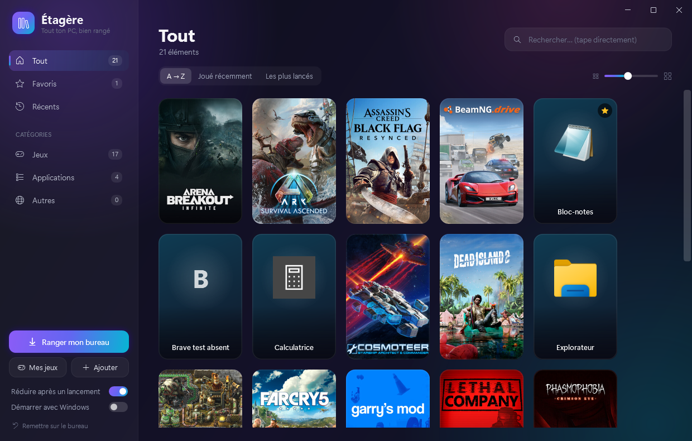

# Étagère

Un lanceur Windows qui range tous les raccourcis du bureau et les jeux Steam / Epic Games dans une jolie fenêtre, et les lance d'un clic.

## Télécharger

👉 **[Etagere.zip (dernière version)](../../releases/latest/download/Etagere.zip)** : dézippe et lance `Etagere.exe`, rien à installer.

L'app se met à jour toute seule à chaque lancement.

## Pour le développeur

- `build.ps1` compile `dist\Etagere.exe` avec le compilateur C# fourni par Windows (.NET Framework 4, WPF).
- `release.ps1 1.0.1 "notes"` publie une nouvelle version : le tag déclenche GitHub Actions qui compile et crée la release.
